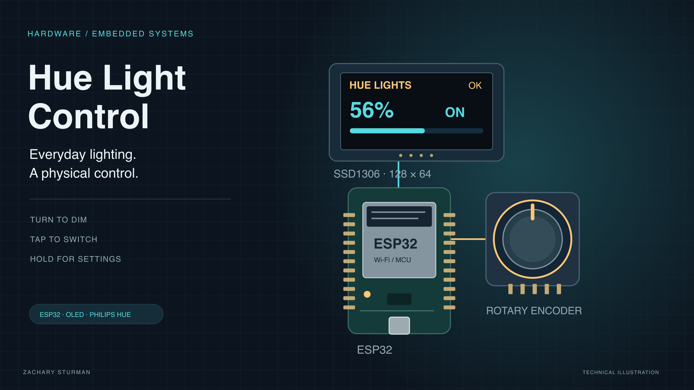
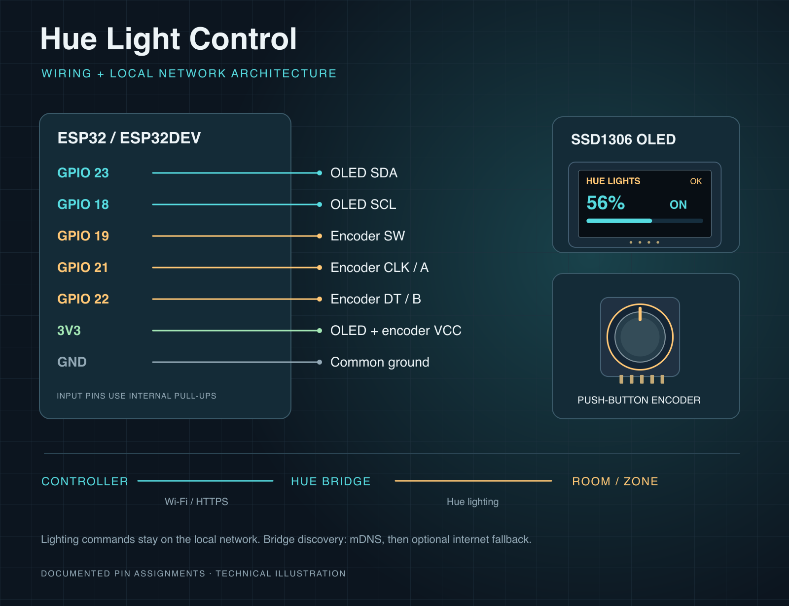

# Hue Light Control

A physical Philips Hue controller built with an ESP32, rotary encoder, and OLED display.

**Status: Complete · Hardware / Firmware · ESP32 / PlatformIO**



*Technical illustration of the documented components; the screen and component arrangement are illustrative.*

A physical dimmer for one Philips Hue room or zone, built from an ESP32, a rotary encoder with a push button, and a 128×64 SSD1306 OLED. Lighting commands travel directly to your Hue bridge over the local network. Bridge discovery uses mDNS first and can fall back to Philips' internet discovery service.

[Source and setup](https://github.com/ZSturman/Hue-Light-Control) · [Portfolio](https://zacharysturman.com/projects/hue-light-control) · [Project in Notion](https://app.notion.com/p/3f5aec944d3c811699d5c9752bb4af87) · [Portfolio assets and validation](docs/PORTFOLIO.md)

## Why it exists

Everyday room lighting benefits from a control you can find by touch. This completed controller makes brightness and on/off available on one knob, with an OLED that explains the current state and any connection problems. Firmware keeps physical input and rendering separate from network requests, and includes diagnostics and recovery on the device itself.

## Features

- Turn to dim, tap to switch, and hold to enter settings.
- Responsive input and display loop with a separate network task.
- Local HTTPS lighting control, reused connections, and paced brightness updates.
- On-device health, encoder, I2C, screen, and connection diagnostics.
- Wi-Fi reconnects, bridge rediscovery, persistent settings, and watchdog recovery.

## Demo flow

With the controller configured and connected, tap to turn the room on, turn the knob to adjust brightness, then hold for two seconds and release to inspect **Status & help**. Return to the main screen and tap to turn it off. Physical operation is reported complete by the builder; see the validation record for checks performed during portfolio packaging.

| Action | What it does |
| --- | --- |
| **Turn** | Brightness up / down |
| **Tap** | Room on / off |
| **Hold 2 s, then let go** | Open **Settings** |
| **Hold 6 s, then let go** | Restart the device |
| **Hold while plugging in** | Boot straight into Settings (recovery) |

Holding for more than about a second switches the screen to a countdown that always says what letting go will do: *cancel*, then *Settings*, then *Restart*. Turning the knob while holding cancels.

The header's right corner shows `OK` when everything works. If something is wrong it shows a short tag (`WIFI`, `HUE`, `AUTH`, …), and the bottom line alternates between the exact problem and *"Hold 2s for help"*.

---

## Hardware



| Part | ESP32 pin |
| --- | --- |
| OLED SDA | GPIO 23 |
| OLED SCL | GPIO 18 |
| OLED VCC / GND | 3V3 / GND |
| Encoder button (SW) | GPIO 19 |
| Encoder CLK (A) | GPIO 21 |
| Encoder DT (B) | GPIO 22 |
| Encoder + / GND | 3V3 / GND |

All encoder pins use the ESP32's internal pull-ups. Pins are defined in [`include/config.h`](include/config.h).

**Adding hardware:** GPIO 23/18 are the I2C bus. Extra I2C sensors can share those two wires (use **Settings → I2C scan** to confirm they're seen). Avoid GPIO 0, 2, 5, 12 and 15 for buttons; they are boot-strapping pins and can stop the board from booting if they are held at the wrong level. More peripherals means more current, so see *Power* below.

## Setup

1. Install [PlatformIO](https://platformio.org/) (VS Code extension or CLI).
2. Copy `.env.example` to `.env` and fill it in:
   - `WIFI_SSID` / `WIFI_PASSWORD`: must be a **2.4 GHz** network.
   - `HUE_BRIDGE_IP`: optional. If blank or wrong, the device searches for the bridge.
   - `HUE_USERNAME`: a Hue API key (see below).
   - `HUE_GROUP_ID` / `HUE_GROUP_NAME`: the room or zone to control.
3. Build and upload: `pio run -t upload`, then `pio device monitor` to see the logs.

### Getting a Hue username (API key)

1. Press the round link button on top of the bridge.
2. Within 30 s, run:
   ```sh
   curl -k -X POST https://<bridge-ip>/api -d '{"devicetype":"hue_light_control#esp32"}'
   ```
3. Copy the `"username"` value into `.env`.

### Finding the group ID

```sh
curl -k https://<bridge-ip>/api/<username>/groups
```

Each top-level key (`"1"`, `"2"`, …) is a group ID. Use the one whose `"name"` matches your room.

---

## Settings screen

Hold the button for 2 seconds and let go. Inside Settings: **turn** to move, **press** to select, **hold 1 s** to go back. Settings closes itself after 2 minutes idle.

The layout is built for the common two-colour 0.96" OLED: titles stay inside the yellow top band (rows 0–15) and everything else sits in the blue area below it.

### Main menu

| Item | Use it for |
| --- | --- |
| **Status & help** | 4 pages (turn to flip): *Health* (what's wrong and how to fix it), *Wi-Fi* (signal, IP, last disconnect reason), *Bridge* (IP in use, last HTTP code, Hue error text, last success), *Device* (uptime, boots, last reset reason, memory) |
| **Test & fix** | Checks Config, Wi-Fi (incl. signal), Bridge, Hue (API key + room) and Memory, showing PASS/WARN/FAIL. It also *fixes* what it can: reconnects Wi-Fi if it's down and searches for the bridge if it moved. Turn to highlight a line and see its full detail in the title |
| **More settings** | Opens the second menu below |
| **Exit** | Back to the light control screen |

### More settings

| Item | Use it for |
| --- | --- |
| **Flash lights** | Blinks the room once to prove the whole chain works |
| **Reconnect Wi-Fi** | Fully power-cycles the Wi-Fi radio and reconnects |
| **Find bridge** | Searches via mDNS, then Philips' discovery service; switches to the bridge's new IP if it moved |
| **Knob test** | Live encoder position, presses, raw pin levels and a bad-step counter (flags noisy wiring) |
| **I2C scan** | Lists every device on the I2C bus |
| **Screen test** | Full white / checkerboards / outline, for dead pixels |
| **Screen off** | Sleep timeout: 15 s, 30 s, 1 m, 5 m, Never |
| **Contrast** | OLED contrast: Low / Med / High |
| **Flip screen** | Rotate 180° for upside-down mounting (note: this also moves the yellow band to the bottom) |
| **Restart** | Press twice to confirm |
| **Factory reset** | Press twice to confirm. Clears saved settings and any discovered bridge IP (the `.env` values are kept) |
| **< Back** | Back to the main menu |

Display settings and a discovered bridge IP are saved to flash and survive power cuts.

---

## Error codes

| Header | Footer message | Likely cause | What to do |
| --- | --- | --- | --- |
| `WIFI` | Joining Wi-Fi... | Router still booting | Wait. The device retries with backoff |
| `WIFI` | Wi-Fi not found | SSID wrong, out of range, or 5 GHz only | Check `WIFI_SSID`; make sure 2.4 GHz is on |
| `WIFI` | Wi-Fi rejected login | Wrong password, WPA3-only router, or very weak signal | Check `WIFI_PASSWORD`; set the router to WPA2/WPA3 mixed |
| `WIFI` | Wi-Fi dropped | Router restarted or interference | Reconnects on its own |
| `DHCP` | No IP from router | Router's DHCP full or stuck | Restart the router |
| `HUE` | Bridge not reachable | Bridge off, or **its IP changed** | Auto-searches after 3 failures; or run *Test & fix*. Reserve the bridge's IP in your router |
| `AUTH` | Hue key rejected | Username deleted or bridge was reset | Create a new username (above) |
| `ROOM` | Room not found | Group was deleted or re-created with a new ID | Look up the ID again (above) |
| `BUSY` | Bridge busy | Too many requests / bridge overloaded | Backs off automatically |
| `HUE?` | Odd bridge reply | Unexpected HTTP or Hue error | See *Status → Bridge* for the code |
| `MEM` | Low memory | Heap too fragmented for HTTPS | Reboots itself after 2 minutes |
| `CFG` | Settings missing | `.env` empty or missing at build time | Fill in `.env`, re-upload |
| — | Button stuck pressed / Check button wiring | The button input has read "pressed" for 15 s+: SW wire shorted to GND, loose, or a faulty encoder module | Check the SW → GPIO 19 wire and the module's GND. The button is ignored until it reads released again; the knob still works |

### Responsiveness

- **One kept-alive connection to the bridge.** Setting up an encrypted (TLS) connection takes about 2 s on an ESP32. The firmware does it once and then reuses the connection, like the Hue phone app, so each command takes roughly 50–270 ms instead of about 2.2 s. If the bridge drops the idle connection, it is reopened in the background so a press never waits for a handshake.
- **The screen updates immediately.** ON/OFF changes the moment you tap. It snaps back only if the bridge can't be reached.
- **Brightness is sent at most every 200 ms** (`BRIGHTNESS_SEND_INTERVAL_MS`), each with a 200 ms fade, so turning the knob looks like one smooth ramp. If the bridge reports it's busy, the firmware backs off on its own.

### Self-healing behaviour

- **Wi-Fi:** every reconnect starts with a clean `disconnect()`. Calling `begin()` while an old attempt is still running is the cause of the well-known ESP32 "connects only every other boot" problem. Retries back off from 2 s to 30 s. Every 5th failure power-cycles the radio. After 20 minutes without Wi-Fi the board reboots (never while Settings is open).
- **Bridge moved:** after 3 failed requests the device searches for the bridge via mDNS (`_hue._tcp`) and then `discovery.meethue.com`. It only switches to a bridge that accepts your username, and it saves the new IP.
- **Hue errors:** the bridge reports most errors (bad key, missing room) as HTTP 200 with an error in the body. These are now parsed and shown, not treated as success.
- **Stalls:** TLS handshakes time out after 5 s (the library default is 120 s). A watchdog reboots the board if the network task stops making progress for 60 s.
- **Button presses while offline** are dropped rather than queued, so the lights never flip unexpectedly later.
- **OLED unplugged/replugged** is detected and the panel is re-initialised.
- The reason for every restart is shown on the boot screen and under *Status → Device*.

---

## Troubleshooting

**`ERR`/`WIFI` after unplugging and replugging**
This is what this firmware's v2 rework targets. Likely causes, most likely first:
1. *ESP32 Wi-Fi reconnect bug.* The old firmware called `WiFi.begin()` repeatedly without disconnecting first. Fixed.
2. *Bridge got a new IP.* If the router or bridge also lost power, DHCP may have handed out a new address. It is now found automatically. To prevent it entirely, add a **DHCP reservation** for the bridge in your router.
3. *Power dip at Wi-Fi start-up.* The radio draws current spikes when it connects. A thin or long USB cable, or a weak charger or hub port, can cause a **brownout reset**. If that happens the boot screen now says *"Last reset: brownout"*. Use a short, good cable and a 1 A+ supply. A 100–470 µF capacitor across 3V3/GND also helps.

Run **Settings → Test & fix** first. It usually points straight at the problem, and fixes Wi-Fi/bridge issues where it can.

**Signal shows "weak" (below −80 dBm):** move the device or router, or add a 2.4 GHz access point. Weak signal also shows up as Wi-Fi "rejected login" (handshake timeouts).

**Knob skips or jumps:** run *Knob test*. A high "bad" count means bouncy contacts or a loose CLK/DT wire. A 10 nF capacitor from each of CLK and DT to GND helps.

**Blank screen:** check the serial log at 115200 baud. It reports `OLED: not found at 0x3C/0x3D` if the panel isn't answering. To restart without unplugging, hold the button for 6 s and let go.

**Serial log:** `pio device monitor` shows every Hue request with its HTTP code and timing, Wi-Fi disconnect reasons, and health changes.

---

## Project layout

```
include/config.h      Pins, timings, thresholds, .env fallbacks
src/main.cpp          setup()/loop(), network watchdog
src/input.*           Encoder + button (press / release with hold time)
src/hue_network.*     Wi-Fi, Hue HTTPS, bridge discovery, self-test (core 0 task)
src/display_ui.*      Main screen and all Settings screens
src/app_state.*       Shared state, health codes, saved settings (NVS)
load_env.py           Turns .env into compile-time defines
old/                  Code from this board's earlier life (Notion/TFT test); not built
```
